## { .portada  #portada}

<div class="logo-box">
  
</div>

<div class="title-area">
  <h1> Creando un chatbot text-to-SQL de bajísimo presupuesto</h1>
  
  <h2>Aprendizajes</h2>
  
  <p><strong>13 de octubre 2026</strong></p>
</div>


## Contenidos 

- Motivación
- Arquitectura
- Cómo se ve
<!--   - Open-WebUI -->
<!--   - Ollama -->
<!--   - PostgreSQL -->
- Etapas del trabajo
- Indicadores disponibles

- Demostración en vivo
- Qué nos falta
<!-- - Próximos pasos -->


## Motivación { .larger-text }


::: incremental
-  LLMs pueden **alucinar** y para usuarios que buscan **estadísticas oficiales**, esto representa un riesgo significativo
- La **confiabilidad de los datos** es fundamental en el contexto del INE
- Hoy este problema ya está básicamente resuelto, pero en abril 2025 todavía quedaba por solucionar.
:::

## Contexto institucional { .larger-text .nostretch }


## Contexto institucional { .larger-text background-image="imagenes/nohayplata.gif" background-opacity="0.15" background-size="69.1%" background-position="50% 61.3%" }

::: incremental

- Heredamos una estación de trabajo con una GPU RTX 4090 del censo
- No hay ni un solo peso para el proyecto.
  - Cualquier presupuesto que tenga esto tiene que venir de nuestro bolsillo.
- Mi bolsillo:
:::

::: fragment
{width=60%}

:::

## Por qué acá {.medium-par}

::: incremental
- Trabajar sin presupuesto nos obliga a trabajar con herramientas Open Source.
    - Trabajar con herramientas Open Source nos obliga a trabajar a más bajo nivel (normalmente).

- Trabajar sin presupuesto nos obliga a optimizar lo más posible el producto.
    - Optimizar el producto nos obliga a entender el funcionamiento de los modelos en mayor profundidad.

- Muchos de estos aprendizajes escalan a nuestras LLMs propietarias favoritas (_Claude_) y además nunca sabemos si algún día un cliente ~~jodido~~ nos pide desarrollar algún producto completamente _on-premises_.
:::

```{=html}
<div class="fragment" style="position:absolute; left:0; right:0; bottom:200px; display:flex; justify-content:center; align-items:center; gap:120px;">
  
  <span style="font-size:180px; line-height:1;">🤝</span>
  
</div>
```

## Qué se podía correr en una RTX 4090 en 2025

::: {.r-stack}

::: {.fragment .fade-in-then-out}


:::

::: {.fragment .fade-in-then-out}


:::


::: {.fragment .fade-in-then-out}
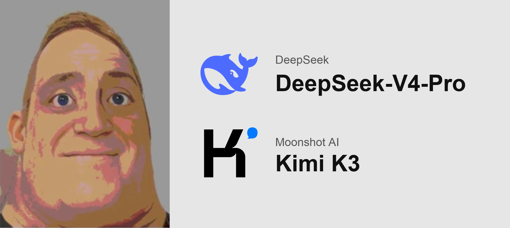

:::

::: {.fragment .fade-in-then-out}
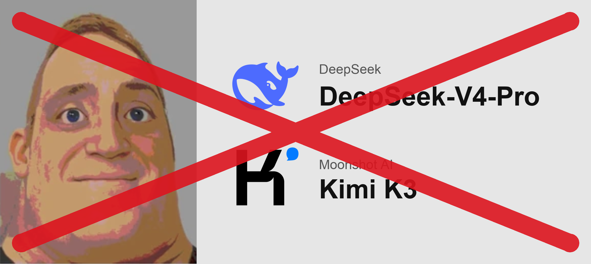

:::

::: {.fragment .fade-in-then-out}
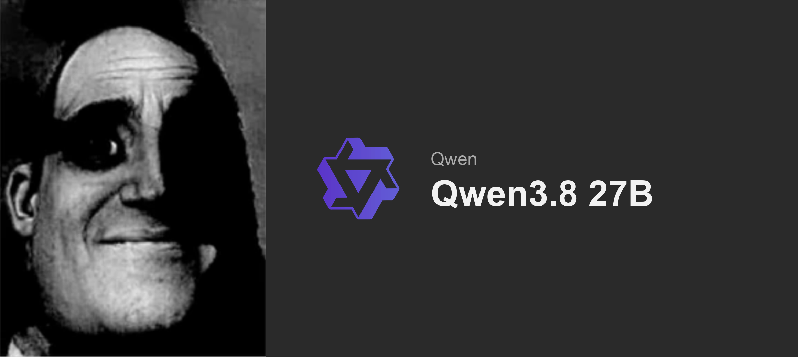

:::

::: {.fragment .fade-in-then-out}
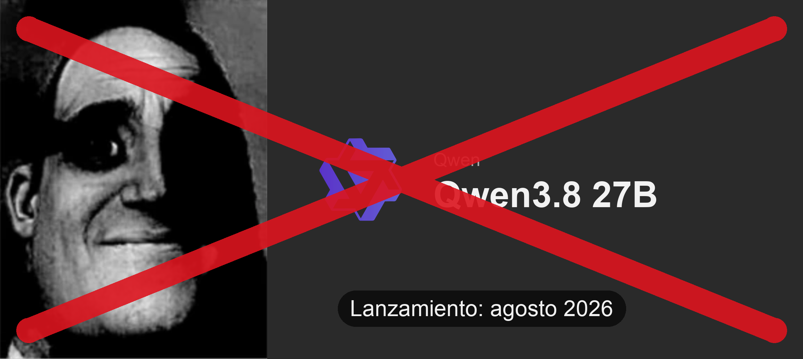

:::


::: {.fragment .fade-in-then-out}
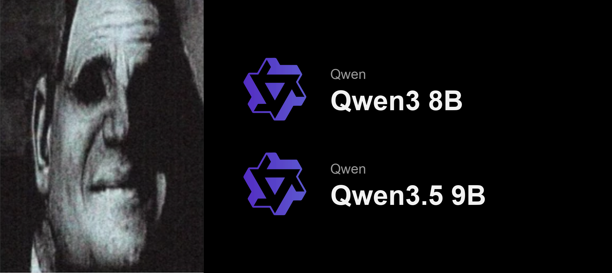

:::

::: {.fragment .fade-in-then-out}

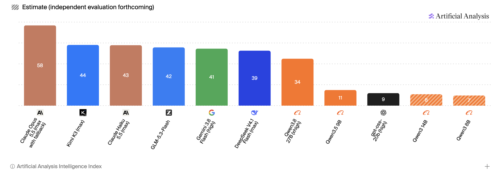

:::


:::

## Solución 

::: incremental
- Desarrollamos un chatbot que se conecta **directamente a datos oficiales** a través de SQL.
- Se le "enseña" a no dar información que no conozca
    - En esos tiempos lo manejábamos con instrucciones dentro del prompt. Hoy se podría usar una capa clasificadora de mensajes con algo como _Jev_ para un funcionamiento más robusto. 
- Esto garantizaría respuestas basadas en **información verificada y autorizada**
- Utilizamos una estructura de datos que permite una **fácil expansión a más indicadores**.
:::


## Arquitectura

:::: {.columns}

::: {.column width="30%"}


Generamos tres componentes principales que interactúan entre sí:

- {height=80px .icon}  **Open-WebUI**: Interfaz de usuario para la interacción con el chatbot
- {height=80px .icon} **Openrouter**: Ruteador de LLMs a la mayoría de proveedores disponibles.
- {height=80px .icon} **PostgreSQL**: Base de datos para almacenamiento persistente
:::

::: {.column width="70%"}
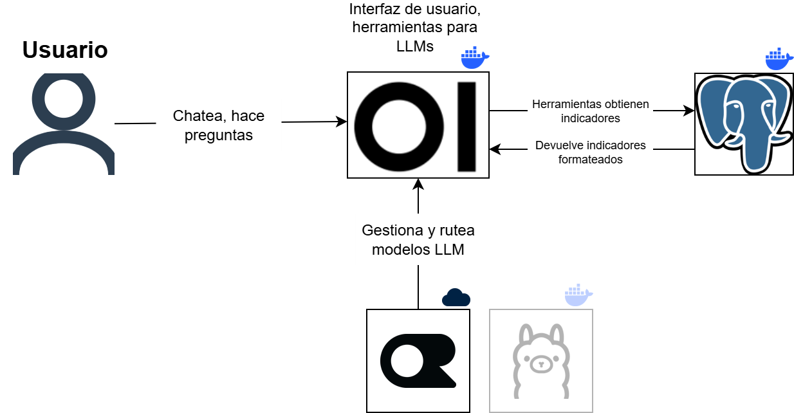{width=100% height=auto}
:::

::::

## Qué son las herramientas

:::: columns

::: {.column width="50%"}

::: fragment
Las herramientas son la pieza clave para que esta arquitectura funcione.
:::

::: fragment
No es más que código de Python que la LLM puede correr para obtener cierto resultado.
:::

::: incremental

::: fragment
El desafío consiste en que la LLM entienda **cuándo** y **cómo** correr este código y 
que el código mismo solo pueda correrse **de forma segura**. 
:::

  - El código y las prompt deben diseñarse cuidadosamente en torno a estos desafíos.
  - Queremos minimizar la responsabilidad de la LLM: **mientras más podamos gestionar con
  código, menor chance de error**.

:::

:::

:::  {.column width="50%}

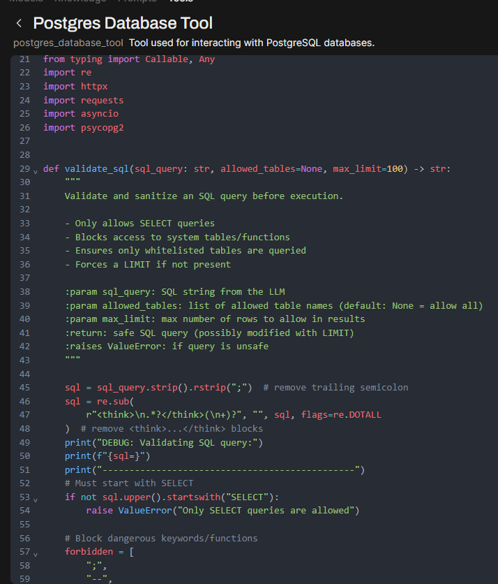{width=70%}
:::

::::

## Indicadores disponibles

Empleo:

  - Población desocupada
  - Población en edad de trabajar
  - Personas en la fuerza de trabajo
  - Población ocupada
  - Tasa de desocupación
  - Tasa de ocupación
  - Tasa de participación laboral

Seguridad:

  - Percepción de aumento de la delincuencia 
  - Victimización hogares por delitos mayor connotación 
  - Victimización hogares por delitos violentos 
  - Victimización personas por delitos violentos 

## Indicadores disponibles

Un vistazo a los datos

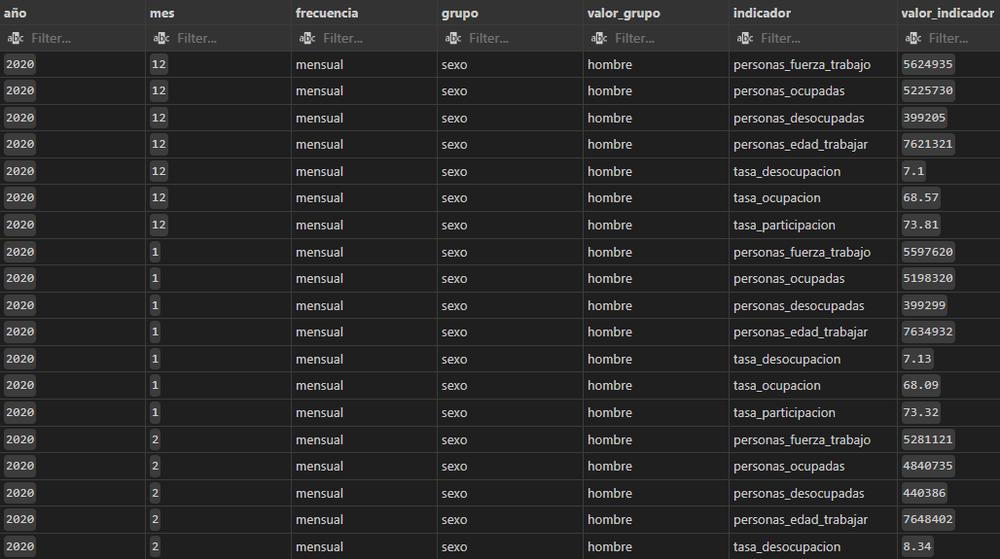{.r-stretch .narrow}


## Cómo se ve

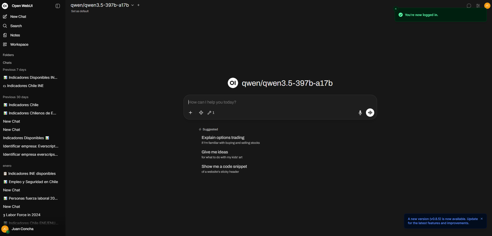


# Aprendizajes


## Aprendizaje: cuidar el contexto {.medium-par}

- En el contexto de este proyecto, contábamos con ~20k tokens antes de que el rendimiento se degradara, por lo que había que ser extremadamente cuidadoso con qué le pasábamos al modelo y qué no.

- Modelos actuales pueden manejar hasta 1M de tokens en su contexto, pero ya en torno a los 300k-400k empiezan a degradarse notablemente.

- Es recomendable ir monitoreando cuánto contexto estamos consumiendo:

::: fragment
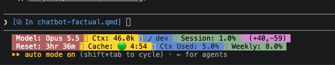{width=80%}
:::

## Subaprendizaje:  _progressive disclosure_ 

:::: columns


::: {.column width=40%}

::: {.incremental .medium-par}

- Una forma de cuidar el contexto es ir pasándole la información de forma parcelada en el modelo.
    - No necesita conocer todo el esquema y metadata asociada de todos los indicadores desde el minuto cero.

- Para el chatbot, le pasamos información básica respecto a los indicadores, los niveles de agrupación y las herramientas disponibles y su flujo de uso en el prompt de sistema:

:::

:::

::: column


::: fragment

``` {.markdown .tall-code code-line-numbers="31-38"}

## Available Tools

**Postgres Database Tool** with three functions:

1. **get_indicator_metadata()** - Returns all available indicators with descriptions and grouping options
2. **execute_query()** - Converts natural language to SQL and returns results
3. **instruct_llm_to_generate_sql()** - Internal use by execute_query

## Tool Usage Workflow

1. **If query is off-topic** → Explain your purpose and suggest examples like "unemployment rate in 2024" or "crime trends in Valparaíso"
2. **If unsure what data exists** → Use `get_indicator_metadata()`
3. **If user requests specific data** → Use `execute_query()`
4. **IMPORTANT**: If you use `get_indicator_metadata()` and find the indicator exists, you MUST follow up with `execute_query()` to fetch actual data

## Data Filtering

**Geographic filters:**
- National: `grupo = 'nacional'`
- By sex: `grupo = 'sexo' AND valor_grupo IN ('hombre', 'mujer')`
- By region: `grupo = 'region' AND valor_grupo = '<REGION_NAME>'`. For all regions:  `grupo = 'region' `

**Region names:**
Arica y Parinacota, Tarapacá, Antofagasta, Atacama, Coquimbo, Valparaíso, Metropolitana, O'Higgins, Maule, Ñuble, Biobío, Araucanía, Los Ríos, Los Lagos, Aysén, Magallanes

**Time filters:**
- Monthly: `frecuencia = 'mensual'`
- Annual: `frecuencia = 'anual' `

## IMPORTANT: available indicators

Personas en la fuerza de trabajo, personas ocupadas, personas desocupadas,
 personas en edad de trabajar, tasa de desocupación, tasa de ocupación y tasa de participación. 
 Además, percepción de aumento de la delincuencia en el país,
  victimización de hogares por delitos de mayor connotación social, victimización de hogares por 
  delitos violentos y victimización de personas por delitos violentos, variación del IPC en 
  12 meses y variación mensual del IPC.


```

:::


:::


::::


::: fragment
[Anthropic sobre el tema: writing tools for agents](https://www.anthropic.com/engineering/writing-tools-for-agents)
:::

## Subaprendizaje:  _progressive disclosure_ 

:::: columns


::: {.column width=40%}

::: {.incremental .medium-par}

- Luego puede consultar `get_indicator_metadata` para obtener más datos de cómo consultar un indicador específico.
- Con la información de `get_indicator_metadata` ya puede consultar el indicador en paz
:::


:::: r-stack

::: {.fragment .fade-in-then-out}

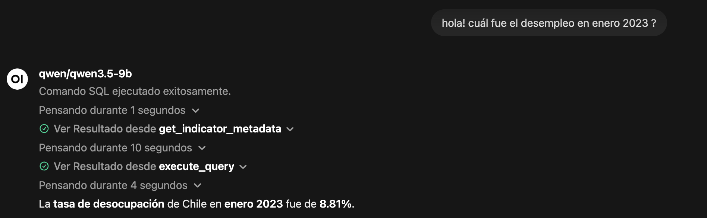

:::


::: {.fragment .fade-in-then-out}

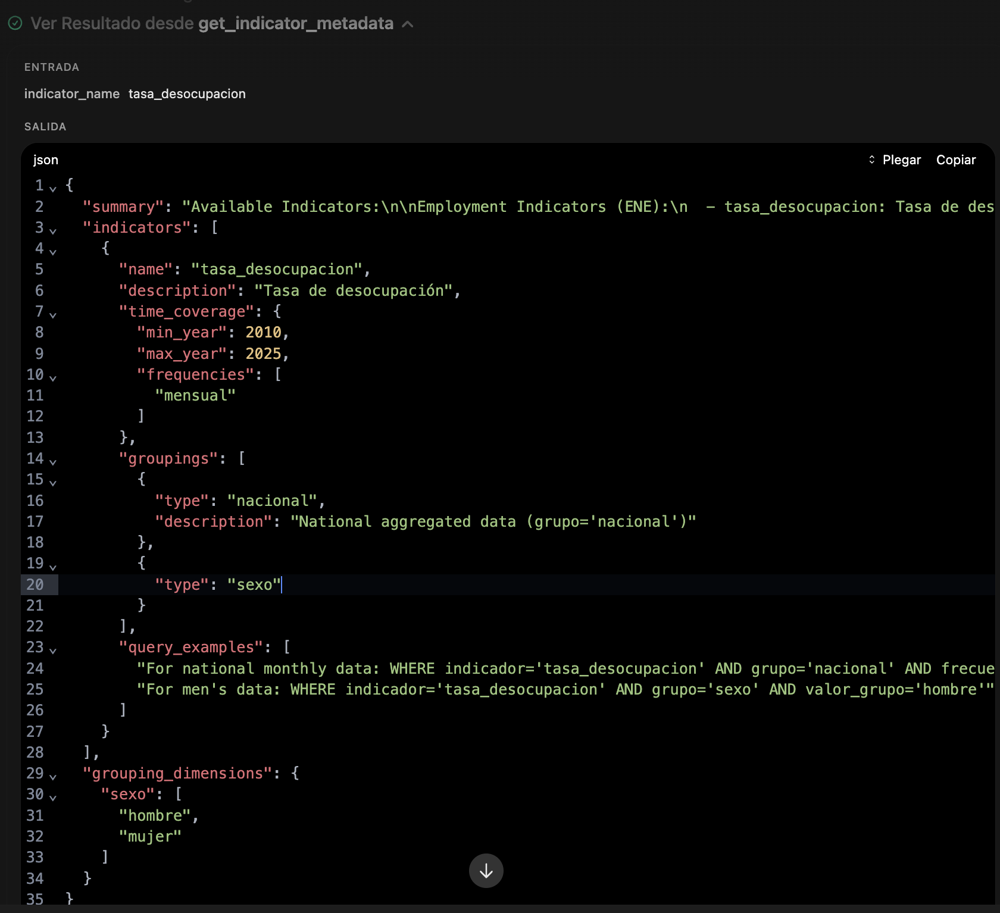

:::


::::

:::

::: column


``` {.markdown .tall-code code-line-numbers="8,13,15-16"}

## Available Tools

**Postgres Database Tool** with three functions:

1. **get_indicator_metadata()** - Returns all available indicators with descriptions and grouping options
2. **execute_query()** - Converts natural language to SQL and returns results
3. **instruct_llm_to_generate_sql()** - Internal use by execute_query

## Tool Usage Workflow

1. **If query is off-topic** → Explain your purpose and suggest examples like "unemployment rate in 2024" or "crime trends in Valparaíso"
2. **If unsure what data exists** → Use `get_indicator_metadata()`
3. **If user requests specific data** → Use `execute_query()`
4. **IMPORTANT**: If you use `get_indicator_metadata()` and find the indicator
 exists, you MUST follow up with `execute_query()` to fetch actual data.

## Data Filtering

**Geographic filters:**
- National: `grupo = 'nacional'`
- By sex: `grupo = 'sexo' AND valor_grupo IN ('hombre', 'mujer')`
- By region: `grupo = 'region' AND valor_grupo = '<REGION_NAME>'`. For all regions:  `grupo = 'region' `

**Region names:**
Arica y Parinacota, Tarapacá, Antofagasta, Atacama, Coquimbo, Valparaíso, Metropolitana, O'Higgins, Maule, Ñuble, Biobío, Araucanía, Los Ríos, Los Lagos, Aysén, Magallanes

**Time filters:**
- Monthly: `frecuencia = 'mensual'`
- Annual: `frecuencia = 'anual' `

## IMPORTANT: available indicators

Personas en la fuerza de trabajo, personas ocupadas, personas desocupadas,
 personas en edad de trabajar, tasa de desocupación, tasa de ocupación y tasa de participación. 
 Además, percepción de aumento de la delincuencia en el país,
  victimización de hogares por delitos de mayor connotación social, victimización de hogares por 
  delitos violentos y victimización de personas por delitos violentos, variación del IPC en 
  12 meses y variación mensual del IPC.


```


:::


::::


[Anthropic sobre el tema: writing tools for agents](https://www.anthropic.com/engineering/writing-tools-for-agents)


## Subaprendizaje:  _progressive disclosure_ 

::: {.incremental .medium-par}

- Respecto a nuestro día a día, mucho de esto se aplica de forma automatizada: skills y MCPs solo leen la metadata con la descripción del skill, hasta que la llaman. Solo en ese momento entra en contexto el skill completo.

- Sin embargo, cuando las documentaciones se extienden puede ser conveniente generar subdocumentaciones y punteros a ellas en las documentaciones más grandes.

- Ejemplo: `CLAUDE.md`/`AGENTS.md` empieza a estar demasiado cargado de instrucciones de todo tipo (UI, cómo correr modelos, cómo funciona el backend, errores clásicos, etc). 
    - Esto genera contexto innecesario porque nuestro agente no siempre necesita saber todas estas cosas.
    - Una opción es tener una carpeta `docs/` con estas documentaciones más específicas y luego poner instrucciones como "para temas de UI: `docs/gestionar_ui.md`".
    - Otra opción es generar `CLAUDE.md`/`AGENTS.md` en subcarpetas: estos los va a leer el agente _solo_ cuando lea, escriba o edite un archivo en esa subcarpeta.

- El espíritu de esto es que finalmente el agente tenga idealmente solo la información necesaria para trabajar, minimizando ruido innecesario.
:::

## Subaprendizaje: maximizar lo determinístico

:::: columns

::: column

::: {.incremental .medium-par}

- Cuando armamos flujos de trabajo, skills o gemas puede ser tentador darle toda la responsabilidad al agente.
- Sin embargo, existen dos problemas con esto:

- Mientras más instrucciones le damos a un agente, más probable es que no pueda seguirlas todas bien (sumado a que más instrucciones, colapsan más el contexto). A esto se le llama "presupuesto de atención".
    
    => queremos minimizar instrucciones a seguir, dentro de lo posible.

- Nunca deberíamos resolver estocásticamente algo que se puede resolver bien y a bajo costo determinísticamente (con scripts, básicamente).

- Ejemplo:
:::

:::


::: column

::: fragment

Una de las herramientas del chatbot es una función `validate_sql`, que recibe una query y la sanitiza:

:::


::: fragment

``` {.python .semi-tall-code}
    sql = sql_query.strip().rstrip(";")  # quitar trailing ;

    sql = re.sub(
        r"<think>\n.*?</think>(\n+)?", "", sql, flags=re.DOTALL
    )  # quitar bloques <think>...</think> 
    sql = re.sub(
        r"^```(?:sql)?\s*\n?(.*?)\n?```$", r"\1", sql, flags=re.DOTALL
    ).strip()  # quitar wrappers ```sql ... ```  ``` ... ``` 
    logger.debug("Validating SQL query: %s", sql)
    # Debe empezar con SELECT
    if not sql.upper().startswith("SELECT"):
        raise ValueError("Only SELECT queries are allowed")

    # Bloquear  keywords o funciones peligrosas
    forbidden = [
        ";",
        "--",
        "pg_",
        "information_schema",
        "COPY",
        "ALTER",
        "DROP",
        "INSERT",
        "UPDATE",
        "DELETE",
        "SET",
    ]
    for word in forbidden:
        if re.search(rf"\b{word}\b", sql, flags=re.IGNORECASE):
            raise ValueError(f"Forbidden keyword detected: {word}")

    # Solo permitir whitelist de tablas:
    if allowed_tables:
        found_tables = re.findall(r"FROM\s+([a-zA-Z0-9_\.]+)", sql, flags=re.IGNORECASE)
        for tbl in found_tables:
            if tbl not in allowed_tables:
                raise ValueError(f"Querying table '{tbl}' is not allowed")

    # LIMIT obligatorio
    sql = re.sub(r'\bLIMIT\s+\d+\b', '', sql, flags=re.IGNORECASE).rstrip()
    sql += f" LIMIT {max_limit}"


```

:::

:::

::::

[Sobre el presupuesto de atención e ingeniería de contexto](https://www.anthropic.com/engineering/effective-context-engineering-for-ai-agents){.small-par}

[Harada et al (2025) -  When Instructions Multiply: Measuring and Estimating LLM Capabilities of Multiple Instructions Following](https://arxiv.org/pdf/2509.21051){.small-par}


## Subaprendizaje: maximizar lo determinístico

:::: columns

::: column

::: {.incremental .medium-par}
- Alternativamente, podríamos haberle pedido al agente como una de sus instrucciones que solo corra prompts que le parezcan seguras y probablemente funcionaría en un 90+% de los casos a costa de degradar un poco su rendimiento general.
- Nos da mejor rendimiento y tranquilidad la alternativa determinística.

::: 

:::

::: column

Una de las herramientas del chatbot es una función `validate_sql`, que recibe una query y la sanitiza:


``` {.python .semi-tall-code}
    sql = sql_query.strip().rstrip(";")  # quitar trailing ;

    sql = re.sub(
        r"<think>\n.*?</think>(\n+)?", "", sql, flags=re.DOTALL
    )  # quitar bloques <think>...</think> 
    sql = re.sub(
        r"^```(?:sql)?\s*\n?(.*?)\n?```$", r"\1", sql, flags=re.DOTALL
    ).strip()  # quitar wrappers ```sql ... ```  ``` ... ``` 
    logger.debug("Validating SQL query: %s", sql)
    # Debe empezar con SELECT
    if not sql.upper().startswith("SELECT"):
        raise ValueError("Only SELECT queries are allowed")

    # Bloquear  keywords o funciones peligrosas
    forbidden = [
        ";",
        "--",
        "pg_",
        "information_schema",
        "COPY",
        "ALTER",
        "DROP",
        "INSERT",
        "UPDATE",
        "DELETE",
        "SET",
    ]
    for word in forbidden:
        if re.search(rf"\b{word}\b", sql, flags=re.IGNORECASE):
            raise ValueError(f"Forbidden keyword detected: {word}")

    # Solo permitir whitelist de tablas:
    if allowed_tables:
        found_tables = re.findall(r"FROM\s+([a-zA-Z0-9_\.]+)", sql, flags=re.IGNORECASE)
        for tbl in found_tables:
            if tbl not in allowed_tables:
                raise ValueError(f"Querying table '{tbl}' is not allowed")

    # LIMIT obligatorio
    sql = re.sub(r'\bLIMIT\s+\d+\b', '', sql, flags=re.IGNORECASE).rstrip()
    sql += f" LIMIT {max_limit}"


```


:::

::::

[Sobre el presupuesto de atención e ingeniería de contexto](https://www.anthropic.com/engineering/effective-context-engineering-for-ai-agents){.small-par}

[Harada et al (2025) -  When Instructions Multiply: Measuring and Estimating LLM Capabilities of Multiple Instructions Following](https://arxiv.org/pdf/2509.21051){.small-par}

## Subaprendizaje: maximizar lo determinístico

:::: columns

::: column

- Alternativamente, podríamos haberle pedido al agente como una de sus instrucciones que solo corra prompts que le parezcan seguras y probablemente funcionaría en un 90+% de los casos a costa de degradar un poco su rendimiento general.
- Nos da mejor rendimiento y tranquilidad la alternativa determinística.

::: {.incremental .medium-par}
- En la práctica, a la hora de desarrollar un skill, agregar scripts de apoyo o separar la tarea en subtareas que puedan tomar distintos agentes con un contexto específico y un set de instrucciones más limitado, permite solucionar una gran parte de este problema.
:::

:::

::: column

::: fragment
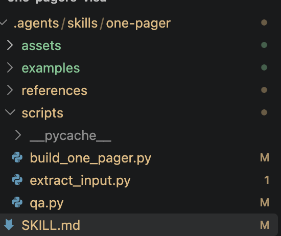{width=70%}
:::


:::

::::

[Sobre el presupuesto de atención e ingeniería de contexto](https://www.anthropic.com/engineering/effective-context-engineering-for-ai-agents){.small-par}

[Harada et al (2025) -  When Instructions Multiply: Measuring and Estimating LLM Capabilities of Multiple Instructions Following](https://arxiv.org/pdf/2509.21051){.small-par}


## Subaprendizaje: APIs para LLMs != APIs regulares

::: incremental
- APIs tradicionalmente no están pensadas para consumo de MCPs
    - Hacemos un _request_ y nos entrega un output que un **computador** debería poder procesar de manera relativamente sencilla.
    - Lo que es sencillo para un computador no necesariamente es sencillo para una LLM.
    - Ejemplo: una API que nos entrega 10mil filas de una tabla es fácil de manejar con nuestro lenguaje de programación favorito (Python), pero contamina enormemente el contexto de la LLM.
- En general cuando llamamos a herramientas queremos que nos entreguen la mayor cantidad de señal posible en el menor número de tokens.

:::

::: fragment
[Anthropic sobre el tema: writing tools for agents](https://www.anthropic.com/engineering/writing-tools-for-agents)
:::

## Ejemplo: APIs para LLMs != APIs regulares


Si confío en que puedo meter el output de la API en el prompt:

::: fragment

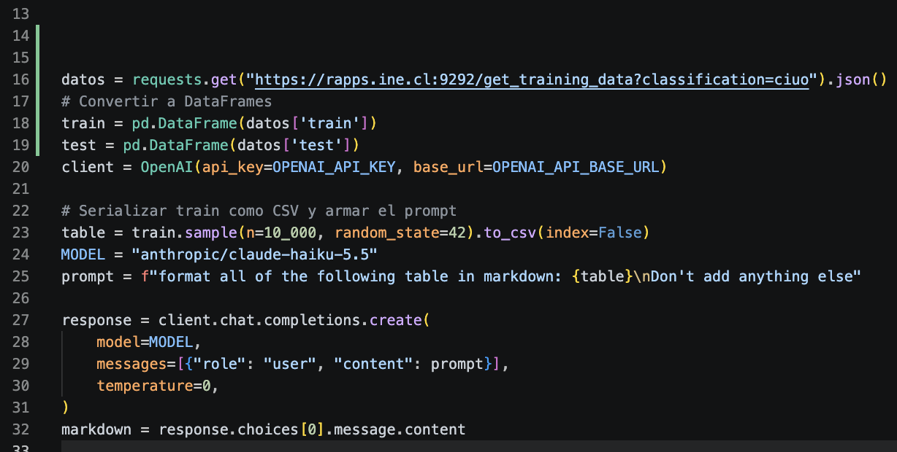{width=70%}

:::

::: fragment

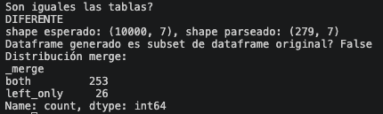{width=70%}

:::


## Aprendizaje: manejo de costos


:::: columns

::: column


::: incremental

- Uno cuando ve los precios de las APIs ve que suelen tener estructuras como: $4 por millón de tokens de input y $20 por millón de tokens en output.

- La intuición nos dice que hay que cuidarse más del output. Más cuando nos damos cuenta que el razonamiento de los modelos se cobra a precio output.

- Esto es cierto para flujos programáticos (por ejemplo, envío un request por cada fila de un dataframe pidiendo una clasificación y una explicación).

- Para flujos agénticos se da vuelta la tortilla y el input empieza a pesar más

    - Hay muchos más turnos y en cada turno se acumula en el input, el input y output de todos los turnos anteriores.
    - Esto lo cobran a precio caché, que tradicionalmente es un 10% del costo de input y últimamente está migrando a ser un 5% (Sonnet 5.5, GPT 6.1-Sol, Gemini 4 Argon)

:::

:::


::: column

::: fragment
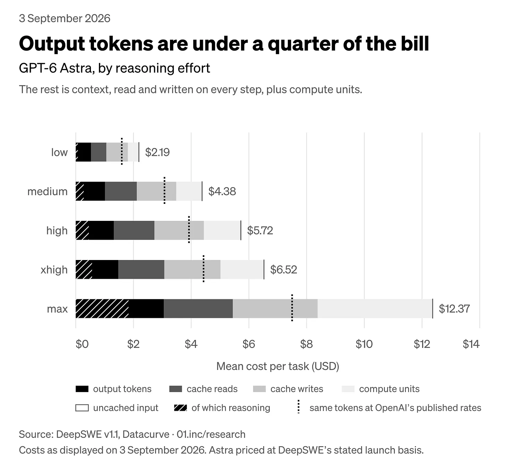
:::

:::


[The token is not the unit of intelligence](https://blog.01.inc/p/the-token-is-not-the-unit-of-intelligence)


::::

## Aprendizaje: manejo de costos

::: incremental

- Para efectos de este proyecto implicó encontrar maneras de hacer que los modelos piensen lo justo y necesario.

- Para efectos de ATF:

  - **OJO:** el caché dura un rato determinado y cuando pasa nos vuelven a cobrar a full precio de escritura de cache.

  - Para Claude Code en cuentas personales es 1 hora, así que mientras pase menos de una hora entre mensaje y mensaje, todo bien.

  - Para Claude Code a precio API (Claude ATF), el tiempo de reset del caché es de **5 minutos**. Es decir, cada vez que esperamos más de 5 minutos entre interacción e interacción **nos van a cobrar a 10-20x el precio** que nos hubieran cobrado de otra manera y nuestros limitados tokens sufren.

    - P/e, Si tenemos 500k de contexto al mandar el mensaje con el caché frío, a 5 USD por millón de input (cache write de Opus 5.5), acabamos de regalar un 5% de nuestro uso mensual a Anthropic ( $500k/1M * 5USD = 2.5 USD$ ).

:::

## Aprendizaje: control token a token {auto-animate=true}

- Como decíamos, parte de la gracia del Open Source es que nos permite más control.

- En este caso, OpenWebUI tiene el concepto de filters, código que permite modificar/trabajar:
    - **inlet:** input del usuario antes de que llegue a la LLM 
    - **outlet/stream:** output de la LLM antes que llegue de vuelta al usuario o mientras se está generando (interceptar el streaming de tokens).

- El proyecto precisamente ocupa un inlet, un outlet y una función stream + outlet:

    - **Inlet para cortar memoria a tres turnos + system prompt**: como los modelos que utilizamos son ~~charchas~~ mejorables, el rendimiento decaía muy rápido en la medida que la conversación iba creciendo. Una solución drástica fue limitar la memoria a solo n turnos.
        - Tenemos flexibilidad para, por ejemplo, mantener el turno original y luego los dos últimos turnos y cortar lo que esté entre medio.
    

## Aprendizaje: control token a token {auto-animate=true}

- Como decíamos, parte de la gracia del Open Source es que nos permite más control.

- En este caso, OpenWebUI tiene el concepto de filters, código que permite modificar/trabajar:
    - **inlet:** input del usuario antes de que llegue a la LLM 
    - **outlet/stream:** output de la LLM antes que llegue de vuelta al usuario o mientras se está generando (interceptar el streaming de tokens).

- El proyecto precisamente ocupa un inlet, un outlet y una función stream + outlet:

    - **Outlet para loggear interacciones a Postgres**: tool calls entre turno y turno; tokens de input, output y pensamiento; costo de la interacción; mensaje de input del usuario y output del modelo; ID del chat, del mensaje y del usuario.

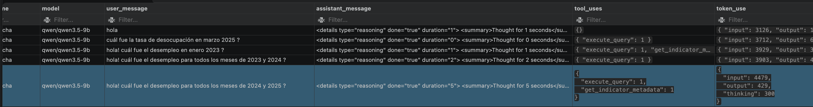{.nostretch width=100%}

## Aprendizaje: control token a token {auto-animate=true}

- Como decíamos, parte de la gracia del Open Source es que nos permite más control.

- En este caso, OpenWebUI tiene el concepto de filters, código que permite modificar/trabajar:
    - **inlet:** input del usuario antes de que llegue a la LLM 
    - **outlet/stream:** output de la LLM antes que llegue de vuelta al usuario o mientras se está generando (interceptar el streaming de tokens).

- El proyecto precisamente ocupa un inlet, un outlet y una función stream + outlet:

    - **Respuestas determinísticas cuando el output de la tool es muy grande**: en línea con aprendizajes anteriores, si la solicitud del usuario generaba un output de la llamada a la tool de más de 12 filas, se reemplaza el output con una respuesta determinística, con el output parseado.
        - Hoy los harnesses manejan este tipo de problemas, pero si interactuamos a nivel API, podríamos sufrir de esta forma con tablas grandes.

## Aprendizaje: control token a token

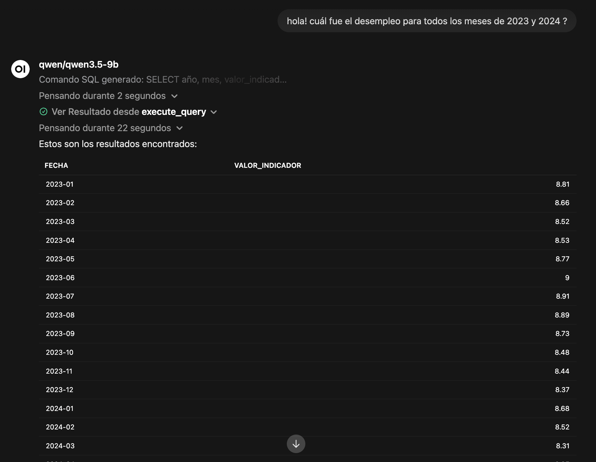

## Aprendizaje: control token a token

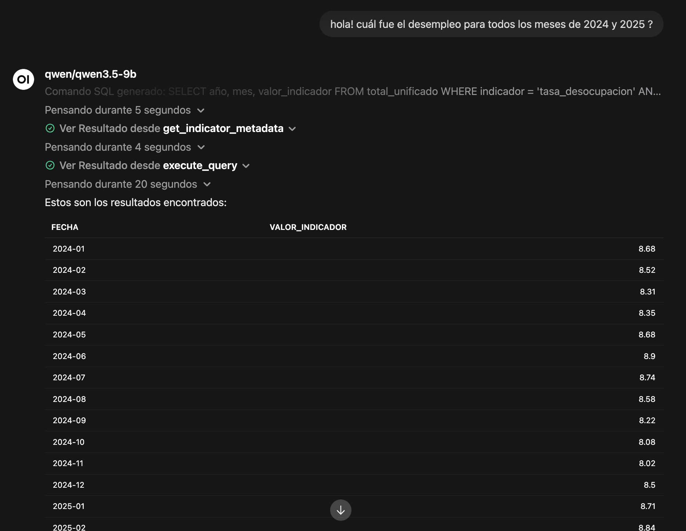

## Aprendizaje: control token a token

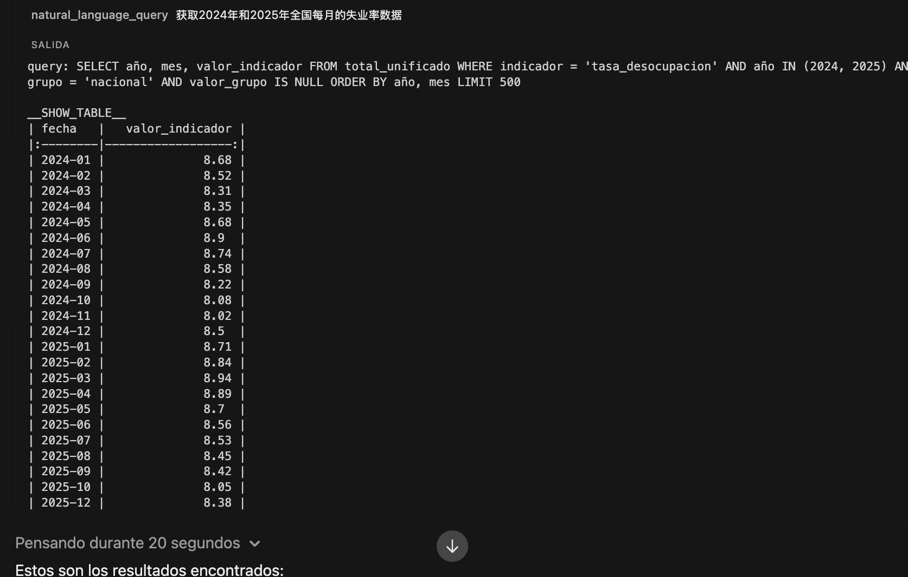


## Aprendizaje: guardrails fuera de la nube

- La nube nos hace muy fácil manejar acceso con IAM, RBAC, etc.

- Fuera de la nube tenemos que ser más cuidadosos

- Buenas prácticas:
    - Permisos limitados de base: cualquier agente en producción debería vivir en un sandbox o contenedor con el mínimo acceso posible para realizar sus tareas. Mucho cuidado con agentes que requieran capacidades destructivas.
    - Capa clasificadora para todo tipo de mensajes indeseados (prompt injection/jailbreaking, extracción de system prompt, payaseos varios).
    - Chatbot solo tiene acceso a usuario de solo lectura de la base de datos.
    - Herramientas inspeccionan query generada y detectan palabras clave prohibidas (DELETE, INSERT, etc ) 
    - Pegamos un LIMIT() a la query para evitar colapsar el contexto sin quererlo


<!-- ## Etapas del trabajo

Para el desarrollo de este piloto hemos pasado por diversas etapas.

::: fragment

**Fase I: estudio y desarrollo prototipo inicial**

  - Estudio de tecnologías disponibles
  - Desarrollo inicial con infraestructura INE
  - Planificación de estructura de datos para consumo de LLM
  - Recolección de indicadores iniciales (ENE)
  - Pruebas de funcionalidad

:::

::: fragment
**Fase II: refinamiento prototipo**

  - Primera expansión de indicadores (ENUSC)
  - Implementación estructura de datos actual.
  - Pruebas internas de funcionalidad y recolección de feedback del equipo de Ciencia de Datos
  - Pruebas internas de funcionalidad y recolección de feedback del equipo de ENUSC
  - Incorporación de comentarios y otras mejoras a la aplicación.
  - Adaptación de la aplicación para conexión a proveedores externos.

::: -->

<!-- 
## Indicadores disponibles 

Tenemos 11 indicadores de disponibles:

**ENUSC:**

| Indicador  | Período | Agrupaciones |
|-----------|-------------|--------------|
| Percepción de aumento de la delincuencia | 2018-2024 | Nacional, región, sexo |
| Victimización hogares por delitos mayor connotación | 2018-2022 | Nacional, región |
| Victimización hogares por delitos violentos | 2023-2024 | Nacional, región |
| Victimización personas por delitos violentos | 2023-2024 | Nacional, región, sexo |


## Indicadores disponibles

Tenemos 11 indicadores de disponibles:

**ENE:**

- Período: 2010 - 2025
- Agrupaciones: nacional y sexo
- Indicadores:
  - Población desocupada
  - Población en edad de trabajar
  - Personas en la fuerza de trabajo
  - Población ocupada
  - Tasa de desocupación
  - Tasa de ocupación
  - Tasa de participación laboral
   -->


<!-- ## Open-WebUI -->

<!-- :::: columns -->

<!-- ::: {.column width="55%} -->
<!-- **¿Qué es Open-WebUI?** -->

<!-- ::: incremental -->
<!-- - Interfaz web de código abierto diseñada para interactuar con modelos de lenguaje -->
<!-- - Experiencia similar a ChatGPT pero auto-hospedada (_self-hosted_) -->
<!-- - Al ser open source, es altamente personalizable y extensible -->
<!-- ::: -->

<!-- **Características principales** -->

<!-- ::: incremental -->
<!-- - Interfaz de chat intuitiva y moderna -->
<!-- - Soporte para múltiples modelos simultáneos -->
<!-- - Sistema de **herramientas (tools)** personalizables basadas en Python  para extender funcionalidades -->
<!-- - Gestión de usuarios y permisos -->
<!-- - Historial de conversaciones persistente -->
<!-- ::: -->

<!-- ::: -->

<!-- ::: {.column  width="45%"} -->

<!-- ::: incremental -->
<!-- **En el proyecto** -->

<!-- - Actúa como la capa de presentación del chatbot -->
<!-- - Permite a los usuarios hacer consultas en lenguaje natural -->
<!-- - Integra herramientas personalizadas para acceder a datos oficiales -->
<!-- - Facilita la autenticación y gestión de sesiones -->
<!-- ::: -->

<!-- **Ventajas** -->

<!-- ::: incremental -->
<!-- - No depende de servicios externos -->
<!-- - Control total sobre datos y privacidad -->
<!-- - Muchísimo más sencillo que desarrollar nuestro propio software de chat. -->
<!-- ::: -->

<!-- ::: {.align-right} -->
<!-- {height=400px} -->
<!-- ::: -->

<!-- ::: -->

<!-- :::: -->


<!-- ## Open-WebUI -->

<!-- ::: align-center -->
<!-- 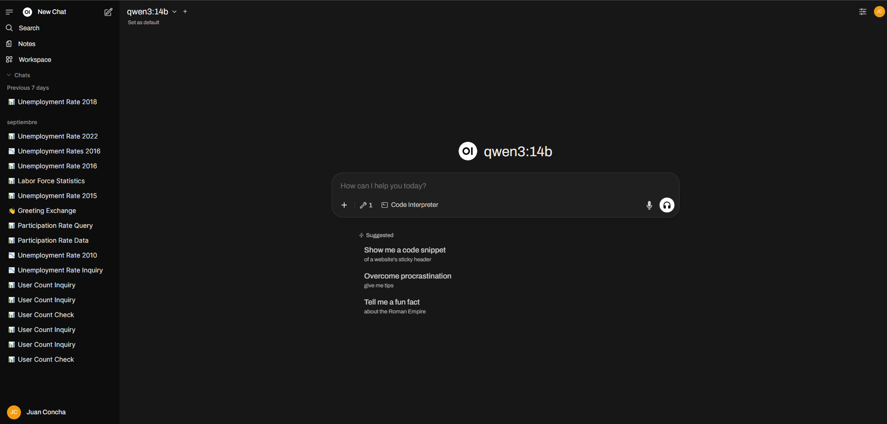{height=1000px } -->
<!-- ::: -->


<!-- ## Ollama -->

<!-- :::: columns -->

<!-- ::: {.column width="55%"} -->
<!-- **¿Qué es?** -->

<!-- ::: incremental -->
<!-- - Plataforma de código abierto para ejecutar LLMs localmente -->
<!-- - Simplifica su descarga, gestión y ejecución -->
<!-- ::: -->

<!-- **Características clave** -->

<!-- ::: incremental -->
<!-- - Soporte para múltiples modelos (Qwen, Llama, Gemma, etc.) -->
<!-- - Gestión automática de memoria y recursos -->
<!-- - Optimizaciones de rendimiento para CPUs y GPUs -->
<!-- - API compatible con OpenAI haciendo fácil su integración -->
<!-- ::: -->

<!-- ::: -->

<!-- ::: {.column width="45%"} -->

<!-- **En nuestro proyecto** -->

<!-- ::: incremental -->
<!-- - Motor de inferencia que procesa las consultas del usuario -->
<!-- - Ejecuta el modelo de lenguaje que interpreta preguntas -->
<!-- - Genera respuestas contextuales basadas en la información disponible -->
<!-- - Se comunica con Open-WebUI a través de su API -->
<!-- ::: -->

<!-- **Ventajas** -->

<!-- ::: incremental -->
<!-- - Ejecución local sin dependencia de APIs externas  -->
<!-- - Control sobre versiones de modelos -->
<!-- - Latencia reducida al eliminar llamadas a servicios remotos -->
<!-- - Sin límites de uso o costos por token -->
<!-- ::: -->

<!-- ::: {.align-right} -->
<!-- {height=200px} -->
<!-- ::: -->

<!-- ::: -->

<!-- :::: -->

<!-- ## PostgreSQL -->

<!-- - Esta es la estructura de las bases de datos. -->

<!-- 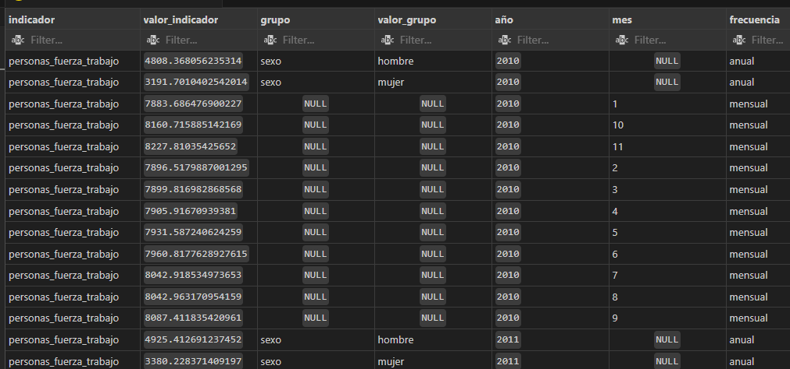{height=750px} -->

<!-- - Busca un sistema estándar que permita desagregar datos y contener datos nacionales -->
<!-- dentro de la misma. -->


<!-- ## Desafíos -->

<!-- **Escalabilidad** -->

<!-- - Cargar un LLM es computacionalmente intensivo -->
<!-- - Dificultad para servir a múltiples usuarios simultáneos -->
<!-- - Requiere planificación cuidadosa de recursos -->

## Demostración en vivo

Y si nos alcanzó el tiempo, ahora veremos [cómo funciona en la práctica](http://localhost:3031/)


<!-- ## Próximos pasos -->

<!-- **Expansión y mejoras** -->

<!-- ::: {.incremental} -->
<!-- - **Ampliar cobertura**: Expandir el número de indicadores disponibles -->
<!-- - **Desarrollo de API**: Estudiar la posibilidad de desarrollar una API dedicada para la conexión de herramientas -->
<!-- - **Más pruebas de seguridad**: Tenemos que asegurarnos que en una gran mayoría de casos -->
<!--   el chatbot no entregue información inventada. -->
<!-- ::: -->

<!-- ## Discusión -->


## { .portada #cierre}

<div class="logo-box">
  
</div>

<div class="title-area">
  <h1> Creando un chatbot text-to-SQL de bajísimo presupuesto</h1>
  
  <h2>Aprendizajes</h2>
  
  <p><strong>13 de octubre 2026</strong></p>
</div>

